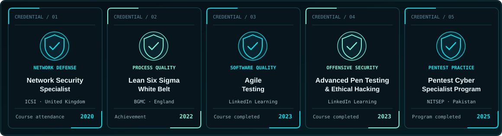

<div align="center">


<br/>

<a href="https://zus3cu.tech"></a>
<a href="https://www.linkedin.com/in/thezubairusman/"></a>
<a href="https://medium.com/@thezubairusman"></a>
<a href="mailto:info@zus3cu.tech"></a>

<br/><br/>

**Offensive security. Production engineering. Trustworthy AI.**

<sub>Application Security &nbsp; / &nbsp; Python Automation &nbsp; / &nbsp; Industrial AI &amp; LLM Safety</sub>

</div>

---

## 01 / The person behind the terminal

I'm **Zubair Usman**, an AI security researcher and penetration tester based in **Ürümqi, China**, where I'm pursuing an **MSc at Xinjiang University** focused on **industrial anomaly detection**.

I work at the intersection of **offensive security, production engineering, and applied AI**. My goal is to make security findings understandable, actionable, and useful to the people building real systems.

```console
zubair@research:~$ cat mission.txt

> Find the weakness before attackers do.
> Automate what should never need to be done twice.
> Make complex security and AI systems easier to trust.
```

## 02 / What I work on

<table>
  <tr>
    <td width="50%" valign="top">
      <h3>01 — Application Security</h3>
      <p>Web and API penetration testing, authentication and OAuth analysis, OWASP assessments, reproducible CVSS-scored findings and remediation guidance.</p>
      <sub>Burp Suite · OWASP ZAP · Nuclei · Nmap · Amass · ffuf · SQLMap</sub>
    </td>
    <td width="50%" valign="top">
      <h3>02 — Security Engineering</h3>
      <p>Python automation, recon and OSINT workflows, security reporting, infrastructure hardening, VPN automation, CI/CD and containerized services.</p>
      <sub>Python · Linux · Docker · FastAPI · Flask · nginx · GitHub Actions</sub>
    </td>
  </tr>
  <tr>
    <td width="50%" valign="top">
      <h3>03 — Industrial AI</h3>
      <p>Anomaly detection, explainability and practical ML applied to connected and industrial systems.</p>
      <sub>PyTorch · anomalib · scikit-learn · SHAP</sub>
    </td>
    <td width="50%" valign="top">
      <h3>04 — AI / LLM Security</h3>
      <p>LLM and RAG evaluation, prompt-injection defense, secure integrations and reliable AI-assisted workflows.</p>
      <sub>LLM evaluation · RAG · Python · AI security testing</sub>
    </td>
  </tr>
</table>

## 03 / Featured builds

<table>
  <tr>
    <td width="50%" valign="top">
      <h3><a href="https://github.com/TheZubairUsman/MalwareGuard-AI">MalwareGuard-AI ↗</a></h3>
      <p>Explainable static malware classification using PE/ELF features, machine-learning models and an API.</p>
      <sub><code>Python</code> <code>scikit-learn</code> <code>FastAPI</code> <code>SHAP</code></sub>
    </td>
    <td width="50%" valign="top">
      <h3><a href="https://github.com/TheZubairUsman/offsec-toolkit">offsec-toolkit ↗</a></h3>
      <p>Automated installation and configuration for 300+ offensive-security tools across 20+ categories.</p>
      <sub><code>Linux</code> <code>Security tooling</code> <code>Automation</code></sub>
    </td>
  </tr>
  <tr>
    <td width="50%" valign="top">
      <h3><a href="https://github.com/TheZubairUsman/BugDrillX">BugDrillX ↗</a></h3>
      <p>A structured bug-bounty learning platform, from recon through web and mobile testing.</p>
      <sub><code>AppSec</code> <code>Methodology</code></sub>
    </td>
    <td width="50%" valign="top">
      <h3><a href="https://github.com/TheZubairUsman/Smart-Cursor-System-2.0">Smart Cursor 2.0 ↗</a></h3>
      <p>Accessibility-focused cursor control using facial gestures and computer vision.</p>
      <sub><code>Python</code> <code>Computer vision</code></sub>
    </td>
  </tr>
</table>

**Also worth exploring**

- **[ssrf-cheatsheet-2025](https://github.com/TheZubairUsman/ssrf-cheatsheet-2025)** — reference material for modern SSRF attack vectors.
- **[VPN Production Platform](https://vpn.zus3c.info)** — OpenVPN/WireGuard automation, customer portal, lifecycle actions and diagnostics. *Python, Flask, nginx, Alibaba Cloud.*
- **Enterprise ERP** *(delivered client project)* — RBAC, sales/purchase workflows, automated tests and production deployment. *Next.js, NestJS, Prisma, PostgreSQL, Redis, BullMQ.*

## 04 / Credentials & continuous learning



The credentials below are drawn from my course and certificate documents. I distinguish **course completion or attendance** from independently certified professional qualifications.

| Year | Credential / course | Issuing organization | Record |
| :---: | :--- | :--- | :--- |
| **2025** | Pentest Cyber Specialist Program | NITSEP | [Verify completion](https://portal.nitsep.pk/course-certificate/cda89fe363) |
| **2023** | Kali Linux for Advanced Pen Testing and Ethical Hacking | LinkedIn Learning | Course completed, Sep 14 |
| **2023** | Agile Testing | LinkedIn Learning | Course completed, Aug 28 |
| **2022** | Certified Lean Six Sigma White Belt | BGMC | Certificate of achievement, Aug 16 |
| **2020** | Certified Network Security Specialist (CNSS) course | International Cybersecurity Institute (ICSI) | Certificate of attendance, Aug 17 |

<sub>The NITSEP course track covered CCNA, CEH, cybersecurity monitoring, wireless testing, penetration testing and bug bounty topics. These course modules are not represented here as separately awarded CCNA or CEH certifications. Full certificate copies are available upon appropriate request.</sub>

## 05 / Research & responsible disclosure

| Area | Work |
| :--- | :--- |
| **Web application security** | Responsibly disclosed a production e-commerce SQL injection with documented evidence and severity assessment (2024). |
| **Identity & OAuth security** | Reported an OAuth 2.0 nonce-related issue to Windsurf (reported CVSS 7.1, 2025). |
| **Security assurance** | OWASP-oriented testing and ISO 27001 gap analysis with reproducible, actionable reporting. |
| **Industrial anomaly detection** | MSc research connecting applied ML, explainability and industrial/IIoT reliability. |

<sub>Disclosures and client work are described only to the extent permitted by responsible-disclosure practices and confidentiality obligations.</sub>

## 06 / My toolchain

<div align="center">


</div>

## 07 / Technical writing

I write about the engineering decisions and security methods behind the work.

- **[Bug Bounty Methodology — Volume 2](https://medium.com/@thezubairusman/bug-bounty-methodology-volume-2-c6e89ae6875a)** — repeatable security testing practice.
- **[Bug Hunting with GPT: Tips, Tricks, and Prompts](https://medium.com/@thezubairusman/bug-hunting-with-gpt-tips-tricks-and-prompts-3841ad93af17)** — AI-assisted security workflows.
- **[Why 95% of Micro-SaaS Startups Fail — and How Solo Founders Can Win](https://medium.com/@thezubairusman/why-95-of-micro-saas-startups-fail-and-how-solo-founders-can-win-in-2025-a971594a9134)** — building and validating software products.
- **Escaping Network Isolation: Zero-inbound SSH Access to a Private GPU Server** — secure remote infrastructure access; find it on [Medium](https://medium.com/@thezubairusman).

<details>
<summary><b>View my GitHub activity</b></summary>

<br/>

<p align="center">
  
  
</p>

<sub>GitHub statistic cards depend on a third-party service and may not always load.</sub>

</details>

---

<div align="center">

### Have something security-critical to build or test?

I work with teams on **Web/API security assessments**, **Python automation**, and **applied AI & LLM security**.

<a href="https://zus3cu.tech"></a>
<a href="mailto:info@zus3cu.tech"></a>

<br/><br/>

<sub>Security first. Automation always. • [GitHub](https://github.com/TheZubairUsman) • [LinkedIn](https://www.linkedin.com/in/thezubairusman/) • [Medium](https://medium.com/@thezubairusman)</sub>

</div>
