<div align="center">



<br/>

<a href="https://zus3cu.tech"></a>
<a href="https://www.linkedin.com/in/thezubairusman/"></a>
<a href="https://medium.com/@thezubairusman"></a>
<a href="mailto:info@zus3cu.tech"></a>

<br/>

**Offensive security × practical AI × production automation**

<sub>Ürümqi, China · MSc researcher at Xinjiang University · Originally from Pakistan</sub>

</div>

---

### `> whoami`

I help teams **find security weaknesses before attackers do** and build the **automation and AI systems** that make their products more resilient.

I'm an AI security researcher and penetration tester pursuing an MSc at **Xinjiang University**, with research focused on **industrial anomaly detection**. My work connects hands-on application security, software delivery and trustworthy AI for industrial and connected systems.

```text
$ cat focus.txt
[01] Offensive Security   → Web/API security, auth flows, responsible disclosure
[02] Security Automation → Python, DevSecOps, infrastructure and reporting
[03] Applied AI          → Anomaly detection, explainability, LLM/RAG safety
```

### `> expertise --active`

<table>
<tr>
<td width="33%" valign="top">

**🛡️ Offensive Security**

Application/API assessments, OAuth and authentication reviews, OWASP testing, reproducible CVSS-scored findings and remediation guidance.

<sub>Burp Suite · ZAP · Nuclei · Nmap · ffuf · Amass · SQLMap</sub>

</td>
<td width="33%" valign="top">

**⚙️ DevSecOps & Automation**

Python security tooling, CI/CD integration, VPN and infrastructure workflows, containers, operational diagnostics and report automation.

<sub>Python · Docker · Linux · nginx · Flask · FastAPI</sub>

</td>
<td width="34%" valign="top">

**🧠 Industrial AI & LLM Safety**

Industrial anomaly detection, interpretable ML, RAG/LLM evaluation and prompt-injection defense.

<sub>PyTorch · anomalib · scikit-learn · SHAP</sub>

</td>
</tr>
</table>

### `> ls featured-projects/`

| Project | What it does | Technologies |
| :--- | :--- | :--- |
| **[MalwareGuard-AI](https://github.com/TheZubairUsman/MalwareGuard-AI)** | Static PE/ELF malware detection with explainable classifications and an API. | Python, FastAPI, scikit-learn, SHAP |
| **[offsec-toolkit](https://github.com/TheZubairUsman/offsec-toolkit)** | Install/configuration toolkit for 300+ offensive-security utilities across 20+ categories. | Linux, security tooling, scripting |
| **[BugDrillX](https://github.com/TheZubairUsman/BugDrillX)** | Structured bug-bounty learning and recon-to-testing roadmap. | Web security, methodology |
| **[ssrf-cheatsheet-2025](https://github.com/TheZubairUsman/ssrf-cheatsheet-2025)** | Reference for modern server-side request forgery techniques. | Web/AppSec research |
| **[Smart-Cursor-System-2.0](https://github.com/TheZubairUsman/Smart-Cursor-System-2.0)** | Accessible cursor control through facial gestures. | Python, computer vision |

<details>
<summary><b>More production work ↗</b></summary>
<br/>

- **[VPN Production Platform](https://vpn.zus3c.info)** — OpenVPN/WireGuard lifecycle automation and customer portal for provisioning, renewals, revocation and diagnostics. *Python · Flask · nginx · Alibaba Cloud*
- **Enterprise ERP** *(client delivery)* — Sales/purchase workflows, RBAC, testing and production deployment. *Next.js · NestJS · Prisma · PostgreSQL · Redis · BullMQ*

</details>

### `> security-research --highlights`

- **2024 — SQL injection:** reported a critical issue in a production e-commerce platform with reproducible evidence and a CVSS-scored report.
- **2025 — OAuth 2.0:** responsibly reported a nonce-related vulnerability to Windsurf (reported CVSS 7.1).
- **Security assurance:** delivered OWASP-oriented assessments and ISO 27001 gap-analysis work with actionable documentation.

<sub>Research and disclosure details are shared within responsible-disclosure and client-confidentiality limits.</sub>

### `> cat toolchain.md`

<div align="center">


</div>

<sub>Security toolkit: Burp Suite · OWASP ZAP · Nuclei · Nmap · Amass · ffuf · SQLMap</sub>

### `> certifications --list`

| Certification | Issuer | Year |
| :--- | :--- | :---: |
| Certified Network Security Specialist (CNSS) | ICSI (UK) | 2020 |
| Lean Six Sigma — White Belt | BGMC (England) | 2022 |
| Kali Linux for Advanced Pen Testing | LinkedIn Learning | 2023 |
| Agile Testing | LinkedIn Learning | 2023 |

### `> tail -f research-notes.log`

I publish technical notes about security testing, practical engineering and building software.

- **[Escaping Network Isolation: Zero-inbound SSH Access to a Private GPU Server](https://medium.com/@thezubairusman)** — private-server access and infrastructure engineering.
- **[Bug Bounty Methodology (Volume 2)](https://medium.com/@thezubairusman/bug-bounty-methodology-volume-2-c6e89ae6875a)**
- **[Bug Hunting with GPT: Tips, Tricks, and Prompts](https://medium.com/@thezubairusman/bug-hunting-with-gpt-tips-tricks-and-prompts-3841ad93af17)**
- **[Why 95% of Micro-SaaS Startups Fail — and How Solo Founders Can Win](https://medium.com/@thezubairusman/why-95-of-micro-saas-startups-fail-and-how-solo-founders-can-win-in-2025-a971594a9134)**

### `> git status --profile`

<div align="center">


</div>

<sub>Stats depend on the availability and rate limits of the external card service.</sub>

---

<div align="center">

### `> let's build something secure`

**Security audit · Python automation · AI/LLM integration**

[**Explore my work**](https://zus3cu.tech) · [**Request a project quote**](mailto:info@zus3cu.tech) · [**Connect on LinkedIn**](https://www.linkedin.com/in/thezubairusman/)

<sub>Bridging cybersecurity and AI for Industry 4.0 · Built with curiosity and responsible engineering</sub>

</div>
